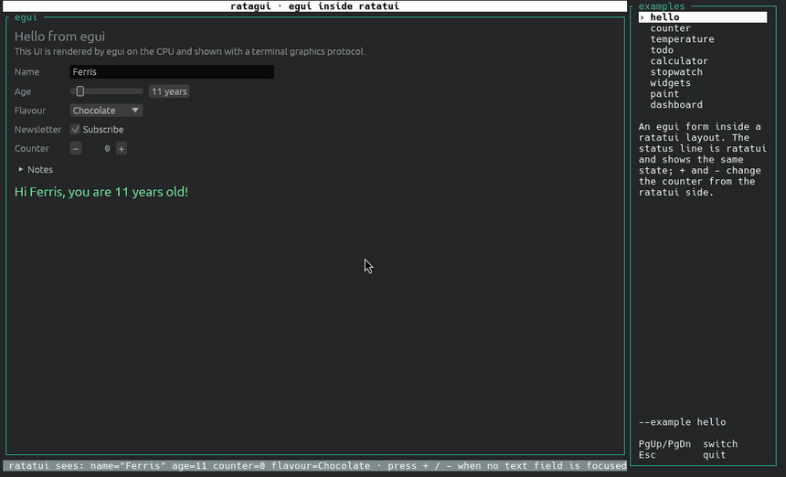

# ratagui

Run [egui](https://github.com/emilk/egui) user interfaces inside
[ratatui](https://ratatui.rs) terminal apps.



egui is rendered on the CPU and shown through your terminal's graphics
protocol (Kitty, Sixel or iTerm2, with halfblocks as a fallback). Terminal
mouse and keyboard input is forwarded to egui.

```rust
use ratagui::{App, EguiTerm, EguiWidget};
use ratatui::Frame;

struct Counter {
    clicks: u32,
}

impl App for Counter {
    fn draw(&mut self, frame: &mut Frame, egui: &mut EguiTerm) {
        let widget = EguiWidget::new(|ui| {
            if ui.button("Click me").clicked() {
                self.clicks += 1;
            }
            ui.label(format!("{} clicks", self.clicks));
        });
        frame.render_stateful_widget(widget, frame.area(), egui);
    }
}

fn main() -> std::io::Result<()> {
    ratagui::run(Counter { clicks: 0 }) // Esc, q or Ctrl+Q quits
}
```

Use `ratagui::egui` rather than your own `egui` dependency, so the versions
match (egui 0.34).

For your own event loop or several egui areas, see `examples/two_panels.rs`.
`ratagui::render_headless` draws an app without a terminal, for tests and
screenshots.

## Examples

```sh
cargo run --example demo   # all examples in one app
```

Or run one on its own: `hello`, `counter`, `temperature`, `todo`,
`calculator`, `stopwatch`, `widgets`, `paint`, `dashboard`, `two_panels`.
Useful flags: `--pixel-mouse` (smooth mouse in kitty, foot, WezTerm, Ghostty,
xterm), `--protocol kitty|sixel|iterm2|halfblocks`, `--screenshot out.png`.

## Limitations

- Requires egui 0.34 (pinned by `egui_software_backend`).
- CPU rendering is slow without optimisations: set `opt-level = 3` for
  dependencies in your dev profile. The `rayon` feature renders in parallel.
- egui popups and windows are clipped to the egui area.
- Without SGR-Pixels mouse mode, the pointer snaps to cell centres.
- Missing glyphs (e.g. CJK) need a font added with `add_fallback_font`.
- Custom GPU painting (`PaintCallback`) is not supported.
